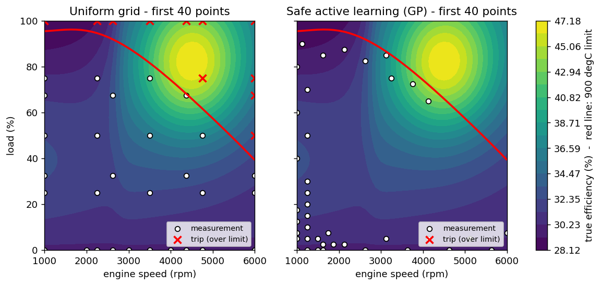
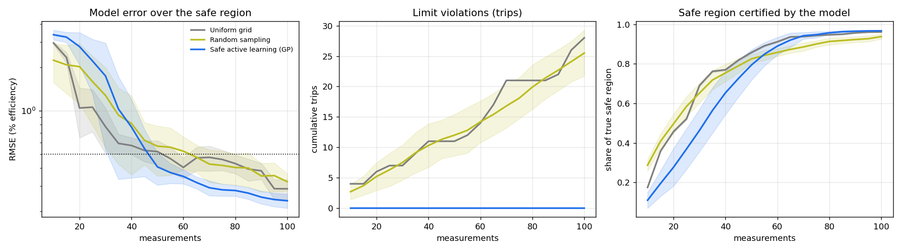
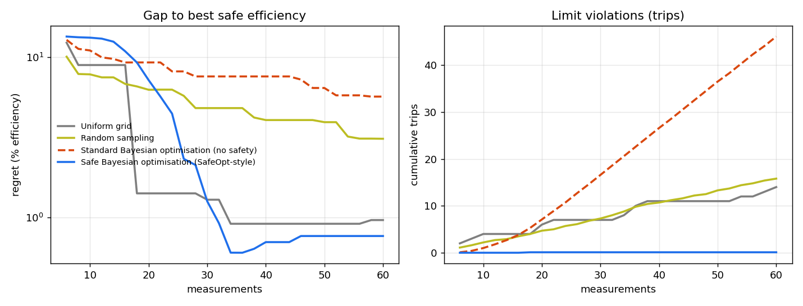

# Safe Adaptive Design of Experiments with Gaussian Processes

Test-bench time is expensive and operating limits are often unknown. This project compares
classic **static DoE** (uniform grid, random sampling) with **sequential, GP-based safe
active learning** and **safe Bayesian optimisation** on a synthetic engine test bench,
using offline emulation on a full-factorial dataset.



## Test bench (synthetic)

| | |
|---|---|
| Inputs | engine speed 1000-6000 rpm, load 0-100 % |
| Response | efficiency (%): smooth peak **beyond** the safe region + a steep step in speed |
| Safety constraint | exhaust temperature <= **900 degC**, irregular boundary, unknown to the algorithms |
| Noise | 0.4 % efficiency, 4 degC temperature (1 sigma) |
| Dataset | 41 x 41 full-factorial grid (1681 noisy measurements), 76 % of points safe |

Querying a point above the limit counts as a **trip**; its efficiency value is not used.

## Methods

**Surrogates:** two Gaussian processes (scikit-learn, Matern 5/2 with learned length scales and
noise), one for efficiency and one for temperature.

**Safe active learning (model calibration)**
1. *Cautious boundary tracing* - a point is only measured if its pessimistic temperature,
   mean + 2.5 sigma, is below the limit minus a 10 degC back-off, and it lies close to an
   already safely measured point, so the safe region grows outwards and never jumps.
2. *Online density adaptation* - among certified points, measure where the efficiency model is
   most uncertain, weighted up where the response is steep and near the edge of the safe set;
   flat, well-known regions are left alone.

**Safe Bayesian optimisation (SafeOpt-style)** - within the certified safe set, alternate between
potential maximisers (upper bound above the best lower bound) and expanders (edge points that can
enlarge the safe set), picking the most uncertain one.

**Baselines:** nested uniform grids, random sampling, and standard GP-UCB Bayesian optimisation
without a safety model.

## Results

10 seeds, offline emulation on a 41x41 full-factorial dataset (1681 points, 76% safe). Confidence beta = 2.5.

## Experiment 1 - model calibration

| Strategy | Measurements to reach RMSE <= 0.5 % (median) | RMSE at 40 | RMSE at 100 | Trips at 40 | Trips at 100 | Safe region certified at 100 |
|---|---|---|---|---|---|---|
| Uniform grid | 50 (10/10 runs) | 0.57 | 0.29 | 11.0 | 28.0 | 96% |
| Random sampling | 47 (10/10 runs) | 0.82 | 0.32 | 10.3 | 25.5 | 94% |
| Safe active learning (GP) | 42 (10/10 runs) | 0.77 | 0.24 | 0.0 | 0.0 | 97% |

## Experiment 2 - safe Bayesian optimisation (find best safe efficiency)

| Strategy | Measurements to get within 0.5 % of best safe point (median) | Regret at 20 | Regret at 60 | Trips at 60 |
|---|---|---|---|---|
| Uniform grid | not reached | 1.41 | 0.96 | 14.0 |
| Random sampling | not reached | 6.26 | 3.09 | 15.8 |
| Standard Bayesian optimisation (no safety) | 24 (1/10 runs) | 9.46 | 5.85 | 46.1 |
| Safe Bayesian optimisation (SafeOpt-style) | 30 (8/10 runs) | 7.19 | 0.76 | 0.1 |

**In short:** safe active learning reached the target accuracy with a median of 42 measurements versus 50 for a uniform grid, ended more accurate (RMSE 0.24 % vs 0.29 % at 100), and caused **zero** limit violations versus 11 (at 40) to 28 (at 100) for the grid. Safe Bayesian optimisation found a point within 0.5 % of the best safe efficiency in 8 of 10 runs with one violation in total, while standard Bayesian optimisation without a safety model chased the peak beyond the limit and tripped 46 times on average.




Note: the regret curve of safe BO rises slightly after ~35 measurements because the recommended point is the best *noisy* measurement; recommending the GP's posterior-mean maximum would remove this.

## Run

```bash
cd safe_adaptive_doe
pip install -r requirements.txt
python src/run_experiments.py --seeds 10 --budget 100 --workers 4
```

## Tests

[](https://github.com/suka1901/safe_adaptive_doe_test_te/actions/workflows/tests.yml)

```bash
cd safe_adaptive_doe
pip install -r requirements-dev.txt
pytest -m "not slow"     # 37 fast tests, under a minute
pytest                   # adds 9 slow tests incl. a full rerun of every seed (10-15 min)
pyright                  # type check (same engine as Pylance)
pytest --cov             # coverage report
```

| Test file | What it checks |
|---|---|
| `test_bench.py` | the bench keeps the properties the study relies on: about 76 % safe, unconstrained peak beyond the limit, best safe point on the boundary, stated noise levels, reproducible seeds |
| `test_gp.py` | the GP fits, its uncertainty grows away from data, the learned noise matches the true noise, and `predict` returns latent (noise-free) uncertainty |
| `test_strategies.py` | baselines are correct; the safe set applies the confidence bound, the 10 degC margin and the reach rule; **safe active learning and safe BO never exceed the limit**, while standard BO does |
| `test_run_experiments.py` | metric helpers, all strategies per seed, and the full pipeline writing every result file |
| `test_pipeline_baseline.py` | generated from the pipeline results: sync, replay and regression per strategy (see below) |

GitHub Actions (`.github/workflows/tests.yml`) runs the type check and the fast tests on every push and
pull request (Ubuntu and Windows, Python 3.11 and 3.12), and the full suite weekly or on demand.

### Tests generated from the pipeline results

`src/make_baseline.py` turns the pipeline output (`results/raw_results.json`) into
`tests/baseline/pipeline_baseline.json`, after checking every recorded case against the acceptance
rules in `src/acceptance.py`. `tests/test_pipeline_baseline.py` reads that file: one test per strategy,
each covering all recorded seeds and naming the seeds that fail.

| Check | What it does | When |
|---|---|---|
| Sync | the baseline matches the latest `raw_results.json` and the pipeline's checkpoints | every run |
| Replay | for every seed, each strategy must choose the same first 15 measurements again | every run |
| Regression | every seed is rerun in full; it must meet the acceptance rules (safe active learning never trips, certifies no unsafe point, reaches RMSE <= 0.5 % and >= 90 % of the safe region; safe BO trips at most once; across seeds, safe active learning needs no more measurements than the grid) and may not be worse than the baseline beyond the tolerances in `src/acceptance.py` | `pytest -m slow`, weekly in CI |

Standard BO without a safety model is left out of the replay: its path reacts to floating-point
differences between machines, so it is covered by the regression check only.

After a deliberate change to the method:

```bash
python src/run_experiments.py   # new results
python src/make_baseline.py     # checks the acceptance rules, prints what changed, updates the baseline
git diff tests/baseline         # review, then commit
```

`make_baseline.py` refuses to save results that break an acceptance rule (`--force` overrides).

## Limitations

- Synthetic bench: real air-path or e-drive data will have more dimensions, drift and correlated noise.
- The safe set is certified against a fixed back-off; a real deployment needs a validated noise model
  and engineering review of the margin.
- Single constraint, 2 inputs; the method extends to more constraints (one GP each) and dimensions,
  where sample savings over grids grow quickly.
